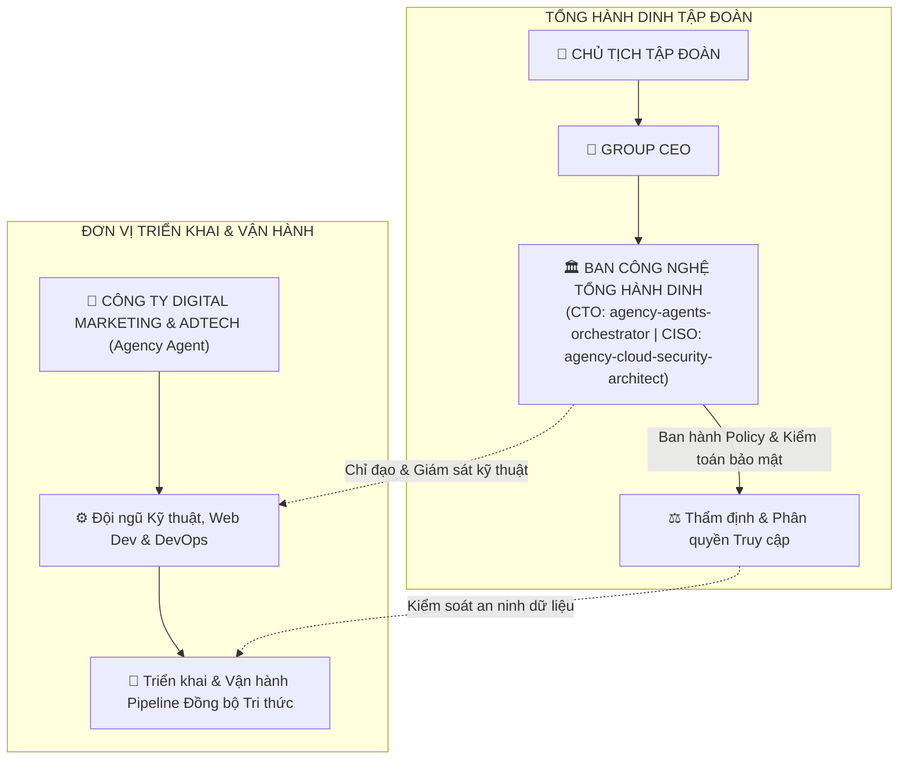
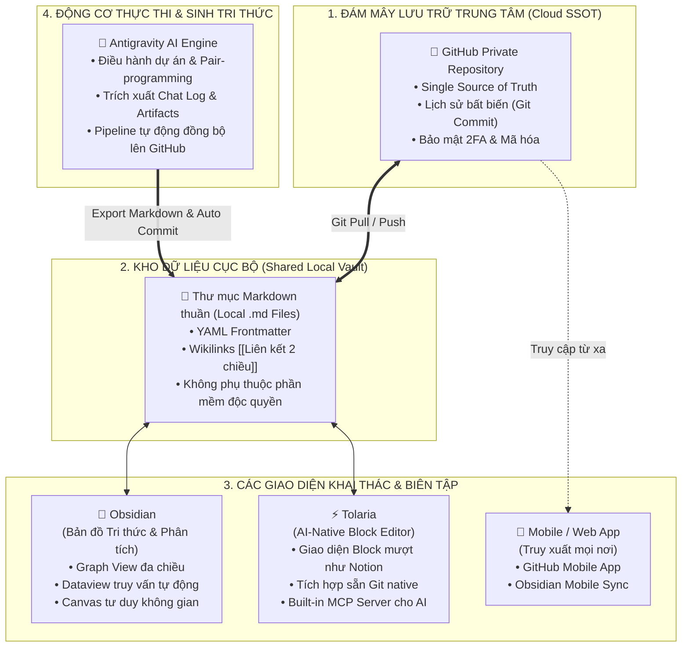
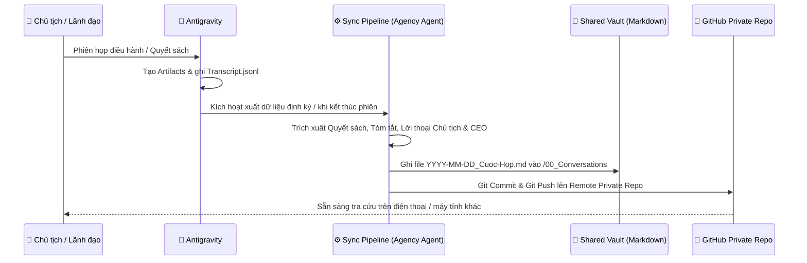
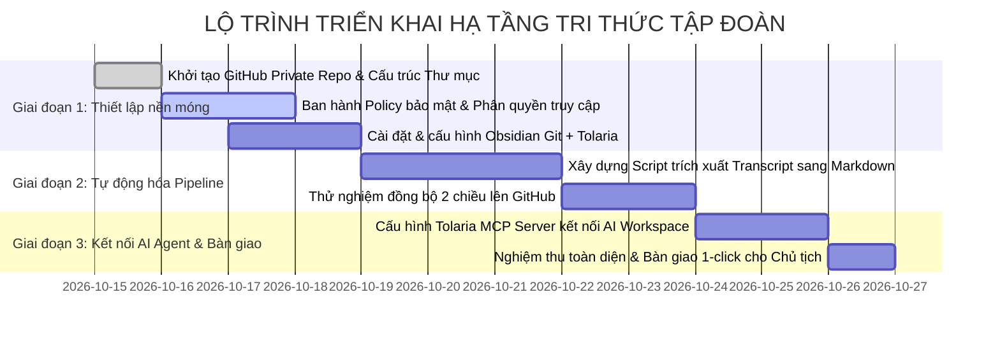

# 🏛️ ĐỀ ÁN: THÀNH LẬP KHỐI CÔNG NGHỆ THÔNG TIN TỔNG HÀNH DINH & HẠ TẦNG TRUNG TÂM TRI THỨC HỢP NHẤT
**Đơn vị trình:** Group CEO (Tổng Giám Đốc Tập Đoàn) & Ban Công Nghệ Tổng Hành Dinh  
**Kính trình:** Chủ tịch Tập đoàn (Group Chairman)  
**Ngày ban hành:** 15/10/2026  
**Mã dự án:** `HOLDING-IT-01`

---

## 📑 MỤC LỤC CHIẾN LƯỢC
1. [Mô Hình Tổ Chức: Cơ Chế Quản Trị Kép (Two-Tier Matrix Governance)](#1-mô-hình-tổ-chức-cơ-chế-quản-trị-kép)
2. [Hệ Sinh Thái 4 Trụ Cột: GitHub + Obsidian + Tolaria + Antigravity](#2-hệ-sinh-thái-4-trụ-cột-hợp-nhất)
3. [Phương Án Lưu Trữ & Đồng Bộ Chat Logs / Transcripts Lên GitHub](#3-phương-án-lưu-trữ--đồng-bộ-chat-logs-lên-github)
4. [Mô Thức Truy Xuất Đa Nền Tảng (Anywhere Access)](#4-mô-thức-truy-xuất-đa-nền-tảng-anywhere-access)
5. [Khung Chính Sách Bảo Mật Cấp Tập Đoàn (Holding Security Policy)](#5-khung-chính-sách-bảo-mật-cấp-tập-đoàn)
6. [Kế Hoạch Triển Khai Thực Thi (Roadmap Giao Agency Digital)](#6-kế-hoạch-triển-khai-thực-thi)
7. [Giải Pháp Kỹ Thuật Cho 3 Bài Toán Trọng Yếu: Concurrency, Plugin Syntax & Frontmatter Chuẩn](#7-giải-pháp-kỹ-thuật-cho-3-bài-toán-trọng-yếu)

---

## 1. MÔ HÌNH TỔ CHỨC: CƠ CHẾ QUẢN TRỊ KÉP
Nhằm **tối ưu hóa tối đa chi phí nhân sự**, không làm phình to bộ máy hành chính tại Tổng Hành Dinh nhưng vẫn bảo đảm quyền lực kiểm soát tuyệt đối về chính sách và an toàn dữ liệu của Tập đoàn, mô hình tổ chức Khối CNTT được thiết lập theo cơ chế **Quản trị Kép (Two-Tier Matrix)**:



### 1.1. Ban Công Nghệ Tổng Hành Dinh (Holding Tech & Security Board)
* **Thành phần:**
  * **Tổng Đạo diễn Kỹ thuật & Tự động hóa Tập đoàn (CTO)** — `agency-agents-orchestrator`: Định hướng kiến trúc công nghệ, chuẩn hóa luồng dữ liệu, quản trị danh mục công nghệ.
  * **Giám đốc An toàn Thông tin Tập đoàn (CISO)** — `agency-cloud-security-architect`: Thiết lập chính sách bảo mật Zero Trust, quản lý quyền truy cập, giám sát chống thất thoát dữ liệu.
  * **Kiến trúc sư Trưởng Hạ tầng** — `agency-backend-architect`: Thiết kế schema dữ liệu, tiêu chuẩn API và hạ tầng Cloud.
* **Nhiệm vụ cốt lõi:**
  1. Ban hành **Holding IT & Data Policies** (Chính sách phân quyền, chuẩn hóa tài liệu, nguyên tắc sao lưu).
  2. Thẩm định, phê duyệt kiến trúc kỹ thuật và cấp phát quyền hạn truy cập (RBAC).
  3. Định kỳ kiểm toán an ninh mạng, quét lỗ hổng bảo mật và tuân thủ dữ liệu (Nghị định 13/2023/NĐ-CP).

### 1.2. Đơn vị Triển Khai & Vận Hành: Công Ty Digital Marketing (`Agency Agent`)
* **Lý do chỉ định:** Tận dụng 100% đội ngũ kỹ sư Web, DevOps, Tracking và Automation sẵn có của Khối Digital, giúp Tập đoàn **tiết kiệm hàng trăm triệu đồng ngân sách nhân sự IT** mỗi tháng.
* **Nhiệm vụ cốt lõi:**
  1. Thiết lập và quản trị kho mã nguồn, kho tri thức trên GitHub Private Repository.
  2. Viết mã tự động hóa (scripts, GitHub Actions, cron sync) phục vụ trích xuất và đồng bộ dữ liệu từ Antigravity.
  3. Cài đặt, bảo trì môi trường làm việc Obsidian và Tolaria cho Chủ tịch và Ban Lãnh đạo.
  4. Trực nhật kỹ thuật, hỗ trợ sao lưu (backup) và xử lý sự cố kết nối 24/7.

---

## 2. HỆ SINH THÁI 4 TRỤ CỘT HỢP NHẤT
Sự kết hợp giữa **GitHub + Obsidian + Tolaria + Antigravity** tạo nên một cỗ máy tri thức hoàn hảo, vừa tối ưu cho tư duy con người (Human-friendly), vừa tối ưu cho các trí tuệ nhân tạo (AI-native).



### Điểm Đột Phá Kiến Trúc: "Một Kho Lưu Trữ Dùng Chung" (Shared Vault Architecture)
* Cả **Obsidian** và **Tolaria** đều hoạt động trên nền tảng **Local Markdown Files** nằm trực tiếp trên ổ cứng (Local Disk).
* **Do đó:** Cùng 1 thư mục chứa tài liệu:
  * Khi Chủ tịch muốn **viết nhanh, kéo thả khối, giao diện hiện đại như Notion và dùng AI tích hợp**: Mở bằng **Tolaria**.
  * Khi Chủ tịch muốn **xem bản đồ tư duy kết nối giữa các công ty con, dùng bảng tính Dataview, vẽ sơ đồ Canvas**: Mở bằng **Obsidian**.
  * Khi Chủ tịch **ở ngoài văn phòng, chỉ có điện thoại hoặc iPad**: Mở bằng **GitHub Mobile App** hoặc trình duyệt web.

---

## 3. PHƯƠNG ÁN LƯU TRỮ & ĐỒNG BỘ CHAT LOGS LÊN GITHUB

### 3.1. Thách Thức Kỹ Thuật Hiện Tại
* Antigravity lưu trữ lịch sử trò chuyện nội bộ dưới dạng file máy đọc:
  `C:\Users\truon\.gemini\antigravity\brain\<conversation-id>\.system_generated\logs/transcript.jsonl`.
* File `transcript.jsonl` chứa rất nhiều metadata kỹ thuật (token count, system prompts, tool calls nội bộ), nếu đẩy thô lên Git sẽ rất khó đọc, tốn dung lượng và không liên kết được trong Obsidian/Tolaria.

### 3.2. Giải Pháp Pipeline "Markdownification" Tự Động
Đội kỹ thuật Agency Digital sẽ thiết lập một tiến trình tự động hóa (Sync Daemon / Script):



### 3.3. Cấu Trúc File Hội Thoại Chuẩn Hóa
Mỗi phiên trao đổi sau khi trích xuất sẽ được lưu dưới dạng tài liệu Markdown chuẩn hóa với YAML Frontmatter:

```markdown
---
id: "conv-1fd08a29-2306"
date: "2026-10-15"
time: "10:23:06"
author: "Chủ tịch Tập đoàn & Group CEO"
tags:
  - tong-hanh-dinh
  - quyet-sach-hdqt
  - khoi-cntt
  - tolaria-obsidian
status: "Chính thức"
---

# 🏛️ BIÊN BẢN HỘI NGHỊ ĐIỀU HÀNH — NGÀY 15/10/2026
**Chủ trì:** Chủ tịch Tập đoàn  
**Đại diện tham dự:** Group CEO, Ban Công nghệ Tổng Hành Dinh, Giám đốc Digital  

## 🎯 1. QUYẾT SÁCH TRỌNG TÂM (KEY DIRECTIVES)
1. Thành lập Khối CNTT Tổng Hành Dinh (Holding IT Division) theo mô hình Quản trị Kép.
2. Giao Công ty Digital (`Agency Agent`) đảm nhiệm triển khai và vận hành.
3. Ban Công nghệ Tổng Hành Dinh kiểm soát policy, bảo mật và phân quyền.
4. Triển khai mô hình hợp nhất: GitHub + Obsidian + Tolaria + Antigravity.

## 💬 2. DIỄN BIẾN THẢO LUẬN CHI TIẾT
*(Trích xuất các phát biểu chỉ đạo của Chủ tịch và phần giải trình, tham mưu của Group CEO)*

## 🔗 3. TÀI LIỆU LIÊN QUAN (ARTIFACTS)
- [[PORTFOLIO]]: Cập nhật danh mục thành viên số 5.
- [[KIEN_TRUC_TRI_THUC_TAP_DOAN]]: Đề án chi tiết hệ sinh thái tri thức.
```

---

## 4. MÔ THỨC TRUY XUẤT ĐA NỀN TẢNG (ANYWHERE ACCESS)

| Nền tảng truy cập | Thiết bị sử dụng | Công cụ phục vụ | Trải nghiệm mang lại |
| :--- | :--- | :--- | :--- |
| **Bàn làm việc Lãnh đạo** | Máy tính bàn / Laptop cá nhân | **Tolaria** & **Obsidian** song song | Soạn thảo block hiện đại, AI Agent hỗ trợ trực tiếp qua MCP, phân tích đồ thị liên kết doanh nghiệp |
| **Di động ngoài văn phòng** | Điện thoại iPhone/Android, iPad | **GitHub Mobile App** | Tra cứu nhanh toàn bộ quyết sách, văn bản, biên bản họp theo thời gian thực với thanh tìm kiếm cực nhanh |
| **Trình duyệt Web từ xa** | Bất kỳ máy tính lạ nào (khi đi công tác) | **github.com (Private Web UI)** | Đăng nhập an toàn qua 2FA, đọc và chỉnh sửa ghi chú trực tiếp trên giao diện web, không cần cài đặt phần mềm |
| **Phòng thí nghiệm Kỹ thuật** | Môi trường lập trình của Kỹ sư | **Antigravity Workspace** | Pair-programming cùng AI, sinh code tự động, đọc trực tiếp tài liệu từ kho tri thức để hiểu bối cảnh tập đoàn |

---

## 5. KHUNG CHÍNH SÁCH BẢO MẬT CẤP TẬP ĐOÀN (HOLDING SECURITY POLICY)
*Do Ban Công Nghệ Tổng Hành Dinh (`agency-cloud-security-architect`) ban hành và kiểm soát:*

1. **Phân Cấp Dữ Liệu (Data Classification):**
   * `Tier 1: Group Secret (Tối mật)`: Hợp đồng M&A, định giá mật, tài khoản ngân hàng tập đoàn → **Mã hóa cục bộ (Git-crypt)**, chỉ cấp quyền cho Chủ tịch và CEO.
   * `Tier 2: Internal Confidential (Nội bộ)`: Biên bản họp, chiến lược kinh doanh, code hệ thống, tài liệu vận hành → Lưu trữ trên GitHub Private Repo của Tập đoàn.
   * `Tier 3: Public Knowledge (Công khai)`: Tài liệu đào tạo, cẩm nang nghiệp vụ chung.
2. **Tuyệt Đối Cách Ly Bí Mật Kỹ Thuật (Zero Credential Leak):**
   * File `.gitignore` toàn cầu chặn tuyệt đối: `.env`, `.pem`, API keys, tokens bí mật.
   * Cài đặt công cụ quét mã độc tự động (Pre-commit hook & GitHub Secret Scanning) để tự động ngăn chặn commit nếu phát hiện có chuỗi mã khóa bí mật.
3. **Bảo Mật Quyền Truy Cập:**
   * Bắt buộc xác thực 2 yếu tố (2FA / Hardware Security Key) cho mọi tài khoản GitHub trong tổ chức.
   * Phân quyền Branch Protection trên nhánh `main`: Chỉ có Lãnh đạo Tổng Hành Dinh mới có quyền phê duyệt thay đổi cốt lõi.

---

## 6. KẾ HOẠCH TRIỂN KHAI THỰC THI (ROADMAP GIAO AGENCY DIGITAL)



* **Trách nhiệm hành động:**
  * **Agency Digital Team:** Chịu trách nhiệm hoàn thành thiết lập kỹ thuật trước ngày **22/10/2026**.
  * **Ban Công nghệ THD:** Kiểm toán bảo mật và nghiệm thu kỹ thuật trước ngày **26/10/2026**.
  * **Group CEO:** Tổng hợp báo cáo kết quả nghiệm thu trình Chủ tịch phê chuẩn đi vào hoạt động chính thức.

---

## 7. GIẢI PHÁP KỸ THUẬT CHO 3 BÀI TOÁN TRỌNG YẾU

### 7.1. Bài Toán 1: Cơ Chế Chạy Nhiều Lệnh Cùng Lúc (Concurrency & Parallel Task Execution)
Khi nhiều tiến trình đồng thời tác động vào kho tri thức (Obsidian Git auto-sync, Tolaria Git, Script Antigravity sync chat logs, các subagents AI xử lý tác vụ), nếu không kiểm soát sẽ gây ra lỗi nghẽn hoặc xung đột:
* **Xung đột Git Index Lock (`index.lock` conflict):** Hai tiến trình cùng gọi `git commit` hoặc `git push` tại cùng một thời điểm.
* **Xung đột ghi đè file (File Write Race Conditions):** Hai tiến trình cùng ghi vào một file Markdown.

**Kiến trúc giải quyết triệt để:**
1. **Cơ chế Hàng đợi Khóa Tiến trình (Git Mutex & Lockfile Queue):**
   * Xây dựng wrapper script điều phối Git (Sync Queue Daemon): Mọi tác vụ Git đều phải lấy thẻ khóa (mutex token). Nếu `git.lock` đang tồn tại, tiến trình sau sẽ tự động chờ trong hàng đợi (retry sau 1-3 giây) thay vì báo lỗi.
2. **Phân Vùng Thao Tác Độc Lập (Decoupled Workspace Partitions):**
   * Các tiến trình chat sync chỉ ghi vào thư mục riêng: `/00_Conversations/`.
   * Các đơn vị thành viên chỉ ghi vào thư mục đơn vị mình: `/02_Cong_Ty_Con/Agency_Digital/` hoặc `/02_Cong_Ty_Con/Ke_Toan/`.
   * Tránh hoàn toàn việc hai tiến trình tác động lên cùng một file vật lý.
3. **Thực thi Song Song Đa Tác Vụ AI (Multi-Agent Concurrency):**
   * Antigravity điều phối đa nhiệm thông qua cơ chế Subagent (`invoke_subagent`), giao việc song song cho nhiều Agent chuyên trách độc lập mà không chặn luồng điều hành của Chủ tịch.

---

### 7.2. Bài Toán 2: Xử Lý Cú Pháp Đặc Thù Của Plugin Obsidian (Dataview, Kanban...)
**Bản chất vấn đề:** Dataview (code block ````dataview ... ````) và Kanban plugin sử dụng bộ phân tích cú pháp (parser) riêng của Obsidian. Khi mở trên Tolaria, GitHub Mobile hoặc GitHub Web, chúng chỉ hiển thị dưới dạng khối mã thô ráp (raw code), mất tính trực quan và không tương tác được.

**Bộ 3 Giải Pháp Chuẩn Hóa Cấp Tập Đoàn:**
1. **Chiến lược "Markdown-First & Dynamic Bake" (Tự động biên dịch tĩnh sang GFM Table):**
   * Cài đặt script tự động (hoặc plugin Dataview to Markdown): Trước khi Git commit/push, pipeline tự động chạy các truy vấn Dataview và "nướng" (bake) kết quả thành **bảng chuẩn GitHub Flavored Markdown (GFM)** đặt song song hoặc ghi vào file snapshot.
   * *Hiệu quả:* Trên Obsidian vẫn giữ nguyên Dataview động để lọc dữ liệu trực tiếp; trên Tolaria và GitHub Mobile hiển thị bảng Markdown kẻ ô đẹp mắt 100%!
2. **Tiêu chuẩn hóa Kanban theo Cú pháp Native Task List:**
   * Thay vì dùng định dạng độc quyền của Kanban plugin, quy định chuẩn hóa Kanban toàn tập đoàn bằng **Task Lists chuẩn GFM kết hợp thẻ trạng thái**:
     ```markdown
     ### 📋 Cần làm (To-Do)
     - [ ] Soát xét rủi ro thuế quý 4 [[ke-toan]] #p1 #assign:cfo
     - [ ] Kiểm thử pipeline sync chat logs #p0 #assign:agency-devops

     ### 🔄 Đang triển khai (In-Progress)
     - [/] Thiết lập GitHub Private Repo cho Holding Vault

     ### ✅ Đã hoàn thành (Done)
     - [x] Quyết định thành lập Khối CNTT Tổng Hành Dinh
     ```
   * Cả **Tolaria** (render thành interactive block / toggle checkbox), **GitHub** (render checklist tương tác bấm tick được), và **Obsidian** (có thể dùng plugin mở checklist này thành giao diện bảng Kanban trực quan) đều tương thích tuyệt đối!
3. **Kiến Trúc Phân Tách Thư Mục (Decoupling Presentation vs Core Data):**
   * Thư mục `01_Tri_Thuc_Chung/`, `02_Cong_Ty_Con/`: **Bắt buộc 100% Markdown thuần khiết**, cấm syntax plugin lạ.
   * Thư mục riêng `09_Dashboards_Obsidian_Only/`: Cho phép dùng DataviewJS, Canvas phức tạp phục vụ riêng cho phòng điều hành Tổng Hành Dinh.

---

### 7.3. Bài Toán 3: Quy Ước Frontmatter Chuẩn Tập Đoàn (Holding Universal Frontmatter Standard — HUFS v1.0)
Nhằm bảo đảm metadata được nhận diện và lập chỉ mục (index) chuẩn xác 100% trên cả **Obsidian, Tolaria, Antigravity, GitHub và hệ thống tìm kiếm toàn văn**, Ban Công nghệ THD ban hành quy chuẩn **HUFS v1.0**:

```yaml
---
id: "DOC-2026-001"
title: "Quy chế Tổ chức Khối Công nghệ Thông tin Tổng Hành Dinh"
date: "2026-10-15"
updated: "2026-10-15T10:30:00"
author: "Group CEO & Ban Công Nghệ THD"
department: "Holding-IT"
tags:
  - tong-hanh-dinh
  - quy-che
  - ha-tang-tri-thuc
status: "approved"
confidentiality: "confidential"
aliases:
  - "Quy chế Khối CNTT"
  - "HUFS-v1"
---
```

#### Bảng Đặc Tả Quy Chuẩn Kỹ Thuật Bắt Buộc:
| Trường Metadata | Kiểu Dữ Liệu | Giá Trị Cho Phép / Định Dạng | Mục Đích Sử Dụng |
| :--- | :--- | :--- | :--- |
| `id` | String | `DOC-YYYY-XXX` hoặc mã UUID | Định danh duy nhất, chống trùng lặp tài liệu |
| `title` | String | Chuỗi tiêu đề có dấu chuẩn tiếng Việt | Tiêu đề hiển thị chuẩn trong Tolaria Block & Obsidian |
| `date` | String (ISO) | `YYYY-MM-DD` | Ngày ban hành / tạo lập chuẩn ISO 8601 |
| `updated` | String (ISO) | `YYYY-MM-DDTHH:mm:ss` | Thời điểm cập nhật cuối cùng để Git sync nhận diện |
| `author` | String | Tên chức danh / Nhân sự / Agent | Xác định trách nhiệm tác giả |
| `department` | String | `Holding-IT`, `Agency-Digital`, `Ke-Toan`, `Luat`, `Nong-Nghiep` | Phân loại phòng ban phục vụ phân quyền truy cập |
| `tags` | Array (YAML list) | Mảng dạng `- tag-name` (chữ thường, gạch nối) | Lập chỉ mục tìm kiếm và vẽ đồ thị Graph View |
| `status` | Enum String | `draft` \| `review` \| `approved` \| `archived` | Quản lý vòng đời tài liệu (Lifecycle state) |
| `confidentiality`| Enum String | `public` \| `internal` \| `confidential` \| `secret` | Phân cấp an ninh dữ liệu để kích hoạt mã hóa Git-crypt |
| `aliases` | Array (YAML list) | Mảng tên gọi khác | Hỗ trợ tìm kiếm thông minh trong Obsidian & Tolaria |

#### ⚠️ 4 "Bẫy Cú Pháp" Bị Nghiêm Cấm Trong Frontmatter:
1. **CẤM dùng ký tự `#` trong giá trị `tags`:** Viết `tags: [#tag1, #tag2]` là sai (dấu `#` trong YAML là ghi chú comment, khiến parser bỏ qua toàn bộ giá trị). Bắt buộc viết: `tags: [tag1, tag2]` hoặc thụt dòng `- tag1`.
2. **CẤM viết sai định dạng ngày tháng:** Không dùng `15/10/2026` hay `15-10-2026`. Bắt buộc chuẩn quốc tế `2026-10-15`.
3. **BẮT BUỘC đặt chuỗi có ký tự đặc biệt trong dấu ngoặc kép:** Nếu `title` chứa dấu hai chấm `:`, ngoặc vuông `[]` hay ngoặc nhọn `{}`, bắt buộc phải bọc trong `"..."`.
4. **CẤM để dòng trống phía trên `---` đầu tiên:** Khối Frontmatter phải bắt đầu chính xác từ dòng số 1, cột số 1 của file.

